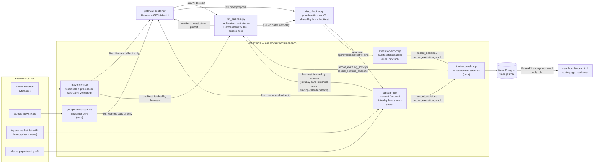

# PROJECT_FRESH_START.md

**Purpose of this file:** a from-zero, code-verified explanation of what this project actually is *today*. Every claim below was checked directly against the repository (code and active configuration) as of 2026-08-29, not recalled from memory or from prior conversations. Where something is a plan rather than a fact, it is labeled as a plan. If you remember this project differently, trust this file over your memory.

**Status note (2026-08-29):** the six-month controlled training run has started (`run_id` live in `backtest_state.json`), following four correctness passes after this file's original 2026-08-27 audit. The architecture below reflects the current, post-training-start code — see `HANDOFF.md` for the live run's own progress, which this file does not track.

Not a history lesson — past decisions are mentioned only when they explain why something works the way it does now.

---

## 1. What Hermes Is

**In one sentence:** Hermes is an AI agent that practices trading US stocks with fake money, so its judgment can be measured and improved before (if ever) it's trusted with real money.

**The concrete setup:**
- **Paper trading** — a real brokerage (Alpaca) account that behaves exactly like a real one, except no real money moves. Every "buy" and "sell" is real software, fake stakes.
- **US equities only, long only** — ordinary US-listed stocks. No shorting (betting a price falls), no options, no crypto, no leverage/margin (`RULES.md` §1).
- **Swing-trading horizon** — a position is meant to be held for days to a couple of weeks, not seconds (day-trading) and not years (investing).

**What Hermes controls vs. what code controls — the single most important distinction in this project:**

| | Hermes (the model) decides | Code decides, unconditionally |
|---|---|---|
| Is this setup worth taking? | ✅ judgment | — |
| How sure am I (1–5 confidence)? | ✅ judgment | — |
| Is this trade allowed at all — size, stop distance, exposure, timing? | ❌ | ✅ `risk_checker.py` re-checks every number, and can block a trade Hermes wants to make |
| Did the broker actually fill it, at what price? | ❌ | ✅ the broker's own answer, never guessed |

Hermes can propose; it cannot approve its own trade. That enforcement layer is deterministic Python, not another AI call — see §4.

**Four different things that are easy to conflate — precise definitions:**

| Term | What it actually is |
|---|---|
| **Hermes** | The persona/identity: `SOUL.md` (temperament) + `AGENTS.md` (procedure). This is *what it's told to be and do*, not the software running it. |
| **The model** | The actual LLM answering each prompt — **GPT-5.4-mini**, reached via OpenAI's Codex/ChatGPT backend (`config.yaml`, verified live: `model.default: gpt-5.4-mini`, `model.provider: openai-codex`, `auth.json` shows exactly one configured provider, `openai-codex`). Originally the tool's shipped default rather than a deliberate choice — but as of 2026-08-28 **locked unambiguously for this training run**: an alternative (OpenCode Go + DeepSeek V4 Flash) was investigated and real, but **abandoned** over an open, unresolved upstream timeout bug for that exact combination (`NousResearch/hermes-agent#61461`) — see `HANDOFF.md`'s 2026-08-28 sections.
| **MCP tools** | Small standalone services (Docker containers) exposing a handful of functions the model can call — `maverick-mcp`, `google-news-rss-mcp`, `alpaca-mcp`, `trade-journal-mcp`, `execution-sim-mcp`. "MCP" = Model Context Protocol, the standard these tools speak (see Glossary). |
| **The harness** | `backtest-harness/run_backtest.py` — a plain Python script (not an AI, not a tool) that drives the *simulated* version of the whole cycle. During a backtest, Hermes has **zero** tool access at all — the harness does every fetch, mask, execute, and journal write itself, and only hands Hermes a text prompt to reason over (`run_backtest.py` module docstring; `AGENTS.md` "When you are backtesting"). |

---

## 2. Current Architecture Map



**Where Docker fits:** every box except `EXT` and `NEON`/`DASH` is its own container, one per service, each on its own private Docker network shared only with `gateway` — no tool can reach another tool directly (`docker-compose.yml`). `execution-sim-mcp` is a dev-only container, `restart: "no"`, not auto-started and not registered as a live tool in `config.yaml`.

**Where the database fits:** Neon Postgres is the *only* database this project's own code writes to persistently. `maverick-mcp` also has its own local SQLite cache (see §7) but that's third-party, vendored, and not something this project's code manages directly.

---

## 3. Tool and Component Catalogue

### Quick-reference table

| Component | What it does | Ours / 3rd-party / external | Who calls it |
|---|---|---|---|
| Hermes (`gateway`) | Runs the model, holds identity/procedure | 3rd-party image (`nousresearch/hermes-agent`), our config (`SOUL.md`/`AGENTS.md`/`RULES.md`) | — (it's the caller) |
| Model (GPT-5.4-mini) | Answers each prompt | External service (OpenAI, via ChatGPT Codex backend) | `gateway` |
| `maverick-mcp` | Technical indicators + price history | 3rd-party (`wshobson/maverick-mcp`), vendored in-repo | Hermes (live) / harness (backtest) |
| `google-news-rss-mcp` | Raw headlines, no interpretation | Ours | Hermes (live only — never used in backtest) |
| `alpaca-mcp` | Account, orders, intraday bars, historical news | Ours | Hermes (live) / harness (backtest, data only) |
| `trade-journal-mcp` | Writes every decision/result/insight/snapshot to Neon | Ours | Hermes (live) / harness (backtest) |
| `execution-sim-mcp` | Simulates order fills for backtesting | Ours | harness only |
| `risk_checker.py` | Enforces `RULES.md` in code | Ours | `alpaca-mcp` (live) and harness (backtest) — same module, mounted once |
| `run_backtest.py` | Drives the whole simulated cycle | Ours | you, from the command line |
| Watchlist + screener | The fixed list of 10 tradable tickers | Ours | risk checker + harness read `watchlist.json`; screener is run by hand, not automatically |
| Dashboard | Read-only live view of journal data | Ours | your browser, directly against Neon |
| Docker Compose | Defines/networks every container | Ours (config only) | you, via `docker compose up` |
| Neon Postgres | The trade journal database | External managed service | `trade-journal-mcp` (write), dashboard (read) |
| maverick's SQLite cache | Local price-history cache | 3rd-party (inside `maverick-mcp`) | `maverick-mcp` internally, transparent to everything else |

### Detail per component

**Hermes / `gateway`** — *What:* the running agent process. *Why needed:* it's the whole point — the thing being evaluated. *How it works:* a Docker container running the `nousresearch/hermes-agent` image, invoked either as a long-running live process or, for backtesting, one-shot via `hermes -z "<prompt>"` (`run_backtest.py`'s `_call_hermes`). *Data in/out:* a text prompt in, a JSON object out. *Persistence:* none of its own — everything durable goes through `trade-journal-mcp`. *Failure:* a malformed JSON reply gets one retry (`ask_hermes`); a second failure raises and the whole cycle fails closed (see §4 "fail-closed").

**Model / GPT-5.4-mini** — *What:* the LLM itself. *Source of truth for its identity:* `config.yaml`'s `model:` block, confirmed live via `hermes status` and `auth.json`. *External:* yes, OpenAI's own infrastructure. *Failure:* a failed call raises `RuntimeError` in `_call_hermes`, no fallback provider configured.

**`maverick-mcp`** — *What:* technical analysis — RSI, MACD, support/resistance, trend direction — plus the price history those are computed from. *Why Hermes needs it:* it's the primary evidence for whether a setup exists at all (`AGENTS.md` Step 4). *3rd-party:* yes, `wshobson/maverick-mcp`, vendored under `maverick-mcp/` and built from its own Dockerfile. *How it works:* an MCP server (HTTP transport) wrapping `yfinance`, which itself scrapes/queries Yahoo Finance. *Data in/out:* ticker + date in, indicator values + price levels out. *Live/historical/cached:* live quotes for live mode; point-in-time historical for backtest (`as_of` parameter); genuinely cached — see §7. *Called by:* Hermes directly in live mode; the harness's `fetch_technicals`/`fetch_bars` in backtest mode. *Source of truth:* Yahoo Finance, several steps removed (yfinance → maverick's own service layer → its cache). *Failure:* a per-ticker fetch failure is caught and reported as `{"error": ...}` inside that ticker's own entry, not a hard crash (`run_backtest.py fetch_technicals`).

Also present in `maverick-mcp` but **not part of Hermes' current data diet:** a `get_stock_fundamentals` tool exists and is registered (`maverick/market_data/tools.py:128-137,185`), backed by `yf.info` (Yahoo Finance) — valuation/financials/trading-stats. Neither `AGENTS.md`'s documented cycle nor `run_backtest.py`'s backtest fetch path ever calls it. It is present in vendored code, technically reachable, and functionally unused today. This is the exact function that must not be confused with the *planned* SEC EDGAR fundamentals source (§9) — they are unrelated, and only one of them (this one) currently exists.

**`google-news-rss-mcp`** — *What:* one tool, `fetch_headlines`. *Why needed:* the news-veto half of entry decisions (§5a). *Ours:* yes. *How it works:* an HTTP GET against `news.google.com/rss/search` (Google's public RSS feed, no key, no auth), parsed with `feedparser`. *Data in/out:* a search query in, a list of `{title, source, published, link}` out — verbatim, no summarization or scoring (`google-news-rss-mcp/server.py`'s own docstring is explicit: "no interpretation of headline text as anything other than a string value"). *Live only:* backtest mode uses Alpaca's historical news instead (§6) — this tool is never called during a backtest. *Failure (corrected 2026-08-29):* a genuine fetch failure (bad HTTP status, or a malformed feed that also returns zero entries) now raises, fetched with an explicit ~10s timeout — it can no longer silently look identical to "no adverse headlines found." A feed that's merely flagged malformed by the parser but still returns real entries is *not* treated as a failure (a very common, non-fatal Google News RSS quirk) — only a genuine, empty failure fails closed.

**`alpaca-mcp`** — *What:* three live jobs (place orders, read account/positions, poll order status) plus three data jobs added for backtesting (historical news, intraday bars, and — as of 2026-08-29 — a real trading-calendar lookup). *Why needed:* the actual broker connection, and — for backtesting — the source of real historical price movement (§6) and a genuine holiday/trading-day answer. *Ours:* yes, a deliberate rebuild of the official Alpaca MCP server, specifically because that one bundled crypto/options ordering with no way to disable it (`alpaca-mcp/server.py` module docstring). *How it works:* HTTP calls to two different Alpaca hosts — `paper-api.alpaca.markets` for orders/account/calendar, `data.alpaca.markets` for bars/news — using the account's API key/secret. *Live/historical:* both, depending on the call. *Called by:* Hermes directly for orders/account (live); the harness (`fetch_news`, `fetch_intraday_bars`, `fetch_trading_calendar_day`) for backtest data — Hermes never calls this tool itself in backtest mode. *Source of truth:* Alpaca — for live orders, this is the authoritative account state (`AGENTS.md` Step 2: "the broker's numbers, not the journal's"). *Failure:* `_pre_trade_check` inside `place_order` runs the risk checker before any order reaches the broker and raises with the specific rule violated if blocked — a live order can never bypass this.

*New (2026-08-29):* `_fetch_calendar_day` hits Alpaca's real `/v2/calendar` endpoint — the harness uses it to tell a genuine market holiday apart from a data OUTAGE on a real trading day (previously indistinguishable, both silently treated as "skip"), and to get that session's *actual* open/close (a real half day, e.g. the day after Thanksgiving, gets its own correct shorter bar grid instead of one padded with bars that never existed).

**`trade-journal-mcp` + Neon** — *What:* the permanent record — every decision, execution result, activity narration, insight, and equity snapshot. *Why needed:* it's the actual source of truth for "what has Hermes done" — nothing lives only in memory. *Ours:* the server code; Neon itself is an external managed Postgres service (`trade-journal-mcp/server.py`, `schema.sql`). *How it works:* `asyncpg` writes over a full-credential connection string (`.env`); the dashboard reads the *same* data through a completely separate path, Neon's Data API with a read-only anonymous role (`schema.sql`'s `GRANT`/RLS section). *Data in/out:* structured trade fields in, rows out on query. *Persistent:* yes, permanently. *Called by:* both Hermes (live, via the MCP tool) and the harness (backtest, by importing `_record_decision`/`_record_execution_result` etc. directly). *Failure:* every decision write is idempotent — retrying with the same `decision_id` is a safe no-op (`ON CONFLICT (decision_id) DO NOTHING`), not a duplicate or an error.

*Mode isolation (2026-08-29):* every row is tagged `execution_mode` (`alpaca`/`backtest`) the instant it's created, not only once resolved — a live decision is tagged `alpaca` at the moment it's proposed, a backtest decision `backtest` the moment it's queued. The public, live-only MCP tools (`get_trade_history`, `get_insight_history`) now hard-filter to live rows only — previously unfiltered, meaning a live reconciliation/reflection call could technically read backtest rows. `record_execution_result` (the live tool) always tags `alpaca` and can no longer be told to tag anything else — the model can't mislabel its own live fills.

**`execution-sim-mcp`** — *What:* simulates a fill (market or limit order) without touching a real broker. *Why needed:* Alpaca can't execute against a past date, so backtesting needs a stand-in (`execution-sim-mcp/server.py` docstring). *Ours:* yes. *How it works:* a pure Python function — no network call of its own — that applies a small fixed slippage (5bps) for MARKET orders and checks a historical day's real low/high range for LIMIT orders. *Called by:* the harness only, never Hermes, never live. *Failure:* returns a `rejected` status with a reason string; nothing throws.

**`risk_checker.py`** — *What:* re-validates every proposed trade against `RULES.md`'s numbers, in code. *Why needed:* "asking Hermes to follow the rules" and "making it structurally impossible to break them" are different guarantees — this module is the second one (its own docstring). *Ours:* yes, and deliberately a single file, mounted read-only into `alpaca-mcp` and imported directly by `run_backtest.py` — one copy, not two that could drift. *How it works:* pure Python functions, zero I/O, zero network — every fact arrives as an explicit argument, which is what makes it exhaustively unit-testable (`risk-checker/test_risk_checker.py`). *Fails closed:* any unknown value (missing equity, undeterminable P&L, an empty watchlist) blocks the trade rather than assuming it's fine.

**`run_backtest.py` (the harness)** — *What:* the whole simulated trading loop. *Why needed:* it's what makes backtesting possible without Hermes ever seeing real-time or future data (module docstring). *Ours:* yes. *How it works:* a Python script invoked from the command line, driving Docker `exec` calls into each MCP container plus one call to `hermes -z` per cycle. *State:* `backtest-harness/backtest_state.json` (current run's portfolio/cursor/`run_id`/seed/window), `backtest-harness/cycle_checkpoint.json` (the in-flight cycle's checkpointed response, normally absent between cycles), and `backtest-harness/quota_pacer_state.json` (weekly call budget) — all local files, not Neon.

**Watchlist + screener** — *What:* the fixed list of 10 eligible tickers (`watchlist/watchlist.json`) and the script that built it (`watchlist/screen_watchlist.py`, `watchlist/check_news_coverage.py`). *Why needed:* `RULES.md` §1/§8 restrict trading to this list only — an unlisted ticker is rejected outright by `risk_checker.py`. *How it works:* the screener is a one-off script run by hand against the S&P MidCap 400 (`screen_watchlist.py`'s own docstring — real published index membership, not a memorized list), filtered by market cap/volume/price/history/news-coverage criteria from `RULES.md` §8. It does **not** run automatically or periodically — the watchlist only changes when someone re-runs it. *Source of truth:* `watchlist.json` is the canonical machine copy; its numbers are mirrored (not parsed) into `risk_checker.py`'s `Context.watchlist`, same drift caveat as `RiskLimits`.

**Dashboard** — *What:* a single static HTML page (`dashboard/index.html`). *Why it exists:* a human-readable view of the journal. *How it works:* client-side JavaScript polling Neon's Data API directly, every 15 seconds, with the read-only anonymous role — no backend of its own. *Called by:* your browser. *Failure:* a failed fetch shows an inline error banner; nothing else on the page depends on it succeeding.

**Docker Compose** — *What:* `docker-compose.yml`, defining every container, network, and volume. *Why:* the single description of the whole running system. Not a "component" that does anything itself — a configuration file.

**maverick's SQLite cache** — *What:* a local `.db` file inside the `maverick-mcp` container (`CACHE_SQLITE_PATH`, `docker-compose.yml`). *Why:* avoids re-fetching from Yahoo Finance on every call. *Ours:* no — this caching behavior is upstream/vendored (`maverick/platform/cache.py`, `maverick/market_data/service.py`), not code this project wrote or maintains. *Persistent:* yes, across container restarts, via the `maverick-data` named Docker volume.

---

## 4. Architectural Decisions Already Applied

| Decision | Problem it solves | Tradeoff |
|---|---|---|
| **MCP separation** (one tool = one small server) | Keeps each capability testable and swappable in isolation | More containers to run/manage than one monolith |
| **Isolated Docker networks per tool** (`docker-compose.yml`) | Bounds blast radius — a compromised/buggy tool can't reach another tool's data or credentials, since there's no network path | More setup complexity; nothing shortcuts through a shared network even when it'd be convenient |
| **Deterministic risk checking outside the model** (`risk_checker.py`) | "We told the model the rules" and "the model cannot break the rules" are different guarantees — this makes the second one true | The checker can't understand nuance the way a model could — it only sees the numbers it's given |
| **Broker reconciliation before anything else** (`AGENTS.md` Step 0) | A crashed cycle can leave a `pending` journal row with an unknown real outcome; the broker's own state is asked first, always | Adds a mandatory step to every live cycle, even when nothing actually broke |
| **Paper-only execution** (`alpaca-mcp`'s hardcoded base URL) | No live-mode flag exists to accidentally misconfigure into real trading | Genuinely cannot go live without a real code change — no "just flip a setting" |
| **News as a veto, never a buy trigger** (`RULES.md` §5a) | News is mostly reactive (the move already happened by publication), and it closes a prompt-injection hole — a malicious headline can at worst block a trade, never cause one | Hermes can never act on a genuinely predictive headline either — the asymmetry is absolute |
| **Persistent journal vs. temporary cycle context** | `RULES.md`/`SOUL.md`/`AGENTS.md` are re-read fresh every cycle (never trusted from memory); trades/insights are written to Neon so they outlive any one process | Every cycle re-pays the cost of reading the same instructions again |
| **Price-history caching / missing-range fetching** (upstream, `maverick/market_data/service.py:204`) | Avoids re-fetching data already on disk; only the gap between what's cached and what's needed is fetched | This behavior belongs to vendored code — this project doesn't control or test it directly |
| **Backtest point-in-time gating** (`as_of` params on technicals/news) | Without it, a "2026-02" backtest cycle could see 2026-08 data by accident | Every data fetch needs an explicit date threaded through it — more plumbing |
| **Company/date masking** (`anonymize.py`) | The model's own training data might "remember" what really happened to a real company on a real date, measuring memorization instead of judgment | Documented, honest ceiling: catches literal name/date leaks, not every paraphrase (e.g. brand names) |
| **Next-day queued execution + intraday chronology** (`QueuedOrder`, `simulate_trading_day`) | A same-day fill let Hermes' decision and its own fill both draw on a day's fully-known outcome — real lookahead | Backtesting takes real intraday market data (Alpaca), not just one daily bar — more data to fetch and verify |
| **Fail-closed safety behavior** (empty watchlist, missing intraday data, unknown P&L) | An unevaluable safety check is treated as failed, never as "probably fine" | A real data gap halts a cycle entirely rather than best-effort continuing |
| **Fixed watchlist restrictions** (`RULES.md` §1/§8) | Bounds the whole system to instruments that were deliberately screened (mid-cap, real liquidity, real news coverage, low memorization risk) — an off-list ticker is rejected regardless of how good the setup looks | The universe doesn't grow or shrink on its own — a real, deliberate screening pass is needed to change it |
| **Essential vs. best-effort observability** (2026-08-29, `run_day`'s `do_observability`) | Cycle data splits into two classes: essential (checkpointed response, portfolio state, trade decisions/results, reflections, risk enforcement — must halt safely and retry deterministically) and best-effort (snapshots, activity narration, dashboard stats — must never halt or replay real trading). Essential work completes and commits FIRST; observability is attempted only after, and a failure there is caught and reported, never rolled back into a retry | A crash between the commit and observability can leave a day's dashboard information missing — accepted explicitly; it can never duplicate a trade or repeat a Hermes call |
| **Durable per-cycle checkpoint** (`cycle_checkpoint.json`) | A validated Hermes response is saved to disk the instant it exists, before any journal write — a retry of a failed cycle reuses the exact checkpointed response instead of calling Hermes (and spending quota) again | One more local state file to reason about; cleared only after the local portfolio-state commit succeeds, never earlier |
| **Holiday vs. outage cross-check** (`fetch_trading_calendar_day`) | Missing daily bars alone used to be assumed a holiday — indistinguishable from a genuine data outage on a real trading day. Now cross-checked against Alpaca's real calendar before deciding which one it is | One more real API call on any day bars come back empty |

---

## 5. How Hermes Decides a Trade Today

This is `AGENTS.md`'s live-mode cycle, in order. The **backtest** mode follows the same rule logic but with the harness performing steps 1–3 and 7–8's data-gathering on Hermes' behalf (Hermes never calls a tool itself in backtest mode).

1. **Reconcile** — check for any `pending` journal row from a crashed prior cycle against the real broker state before doing anything else (`AGENTS.md` Step 0).
2. **Read the rules** — `RULES.md`, fresh, every cycle — never from memory (`AGENTS.md` Step 1).
3. **Fetch account/position state** — from the broker, not the journal (`AGENTS.md` Step 2).
4. **Check circuit breakers** — a null P&L figure is treated as a tripped breaker, not a clear one (`AGENTS.md` Step 2, `RULES.md` §4).
5. **Manage existing positions first** — stops/targets/thesis checks outrank looking for anything new (`AGENTS.md` Step 3).
6. **Evaluate unheld watchlist candidates** — only tickers not already held (`AGENTS.md` Step 4).
7. **Read technical indicators** — RSI/MACD/support-resistance/trend from `maverick-mcp` — this is where model judgment about "is there a setup" actually happens (`AGENTS.md` Step 4.1).
8. **Apply the news veto** — adverse news can block; positive news can never trigger (`RULES.md` §5a).
9. **Choose stop and target** — a real technical level, within `RULES.md` §6a's 5–10% band (`AGENTS.md` Step 4.2).
10. **Calculate position size and reward:risk** — the smaller of two independent caps (§2a/§2b), and reward:risk must clear 2:1 (`AGENTS.md` Step 4.3/4.5, `RULES.md` §6b).
11. **Run deterministic risk checks** — `risk_checker.py`, unconditional, can reject regardless of confidence (`AGENTS.md`, `risk_checker.py`).
12. **Record the decision** — `record_decision`, before attempting execution (`AGENTS.md` "Recording a decision honestly").
13. **Execute (live) or queue (backtest)** — live orders go straight to the broker; backtest decisions are **queued for the next trading day's open**, never filled the same day (see §6, `run_backtest.py`).
14. **Record the actual result** — the real fill, not the intended one (`record_execution_result`).
15. **Reflect at the configured cadence** — every 5th backtest cycle currently; reviews recent closed trades, may refine judgment, may **never** loosen a hard limit (`AGENTS.md` "Reflection", `run_backtest.py`).

**Separating four different kinds of fact in this cycle:**

| Kind | Examples |
|---|---|
| Model judgment | Is there a real setup? How confident? What would invalidate the thesis? |
| Hard-coded rules | Stop must be 5–10% away; reward:risk ≥ 2:1; max 8 positions; sentiment can only veto |
| Broker facts | Current equity, current positions, whether the order actually filled and at what price |
| Mechanical execution | Stops/targets/time-stops fire without anyone "deciding" anything, once set |

**Explicitly, as of this file:** the system described above does **not** maintain a multi-day research dossier on any company, and there is no `WATCHING → READY` (or similar) staged observation process anywhere in the current code. Each cycle's reasoning is self-contained — see §8 and §10.

---

## 6. Live Trading Versus Backtesting

| | Live | Backtest |
|---|---|---|
| Who fetches data | Hermes, calling tools directly | `run_backtest.py` (the harness) — Hermes calls nothing |
| News source | `google-news-rss-mcp` (Google News RSS, real-time) | `alpaca-mcp`'s historical news endpoint, date-gated |
| Date constraint | None — it's always "now" | Every fetch carries an `as_of`/day parameter; nothing after it can be seen |
| May Hermes call tools? | Yes, directly | No — the harness does all I/O, hands Hermes a prompt only |
| Company identity | Real tickers/names throughout | Masked to phonetic aliases (`ALPHA`, `BRAVO`, ...), reshuffled per run (`anonymize.py`) |
| Order execution | Real Alpaca paper order, immediately | Queued from the decision day, filled the **next** real trading day — no earlier than 09:45 ET for entries, exits exempt from that floor (`RULES.md` §7, `simulate_trading_day`) |
| State storage | Neon (journal) + Alpaca (broker, authoritative for positions) | Neon (journal) + a local `backtest_state.json` (authoritative for the in-progress simulated portfolio) |
| Lookahead prevention | Not applicable — live data has no "future" to leak | Point-in-time data gating + masking + next-day queued execution + intraday chronological bar-walking, all four together |

---

## 7. Where Data Lives

| Location | What it holds | Persistent? |
|---|---|---|
| Alpaca (broker) | Real account/position state, live mode | Yes, external, authoritative for live positions |
| Neon Postgres (`trades`, `agent_activity`, `insight_log`, `portfolio_snapshots`) | Every decision, execution result, activity narration, reflection insight, equity snapshot | Yes, permanently |
| maverick's SQLite cache | Price history already fetched from Yahoo | Yes, but purely a cache — always re-derivable |
| `backtest-harness/backtest_state.json` | The CURRENT backtest run's portfolio (cash, holdings, pending orders, today's stopped-out tickers), cursor date, `run_id`, masking `seed`, and the run's own `--start`/`--end` window | Yes, local file, atomic writes |
| `backtest-harness/cycle_checkpoint.json` | The validated Hermes response for the cycle currently in flight — written the instant it's known, cleared only after that cycle's `backtest_state.json` commit succeeds | Local file, but deliberately short-lived — normally absent between cycles; its presence between runs means a cycle didn't finish |
| `backtest-harness/quota_pacer_state.json` | This real calendar week's Hermes-call count | Yes, local file |
| `watchlist/watchlist.json` | The 10 eligible tickers | Yes, hand-maintained, changes only on a re-screen |
| `RULES.md` / `AGENTS.md` / `SOUL.md` | Hermes' instructions | Yes, version-controlled, mounted read-only into the `gateway` container |
| The prompt itself (one cycle) | Everything Hermes reasons over for that single cycle | **No** — exists only for the duration of that one call; nothing persists unless explicitly written via `record_decision`/`log_activity`/etc. |

**If two sources disagree:**
- **Broker vs. journal (live):** the broker wins, explicitly (`AGENTS.md` Step 0/2: "the broker's numbers, not the journal's, which can drift if something broke").
- **`RULES.md` vs. `risk_checker.py`'s mirrored numbers:** these are supposed to always match — `RULES.md` itself warns "change both, together" (§"⚠ Changing a number here?"). If they ever actually drift, `risk_checker.py` is what governs real behavior, since it's the code that runs — but that state is a bug, not a designed hierarchy.

---

## 8. What Is Implemented, Decided, Proposed, or Deferred

### Implemented now
*(Verified present in code/config, not just discussed.)*

- Hub-and-spoke Docker/MCP topology, one container per tool (`docker-compose.yml`)
- `risk_checker.py` enforcing all of `RULES.md` §1–§9 in code, fail-closed on unknowns
- The 15-step live decision cycle above (`AGENTS.md`)
- Sentiment-as-veto-only (`RULES.md` §5a)
- Company/date masking for backtests (`anonymize.py`)
- Point-in-time data gating (`as_of` parameters)
- Next-day queued execution with full real intraday chronology (opening gap → time-stop → queued SELL → 09:45 queued BUY floor → bar-by-bar walk to close) — `run_backtest.py`'s `simulate_trading_day`
- Fixed 10-ticker watchlist, screened from the S&P MidCap 400 (`watchlist/watchlist.json`, `screen_watchlist.py`)
- Persistent, idempotent trade journal in Neon (`trade-journal-mcp`)
- Weekly Hermes-call quota pacing (`quota_pacer.py`) and real per-cycle
  token usage, persisted to Neon on `portfolio_snapshots` (2026-08-28 —
  previously computed and console-printed only, not stored anywhere the
  dashboard could read)
- Reflection loop, triggered every 5th backtest cycle, sample-size-weighted, barred from loosening hard limits
- Read-only dashboard (`dashboard/index.html`) — served locally only via
  `docker compose up -d dashboard` at `http://127.0.0.1:8842` (2026-08-28;
  bound to loopback, not publicly deployed — GitHub Pages was never live
  for this page, and isn't the goal: this is a private learning project,
  and the anonymous Neon role it reads through has no auth beyond
  SELECT-only, a documented, accepted exposure, not a bug)
- `execution-sim-mcp`, backtest-only fill simulator
- `maverick-mcp`'s `get_stock_fundamentals` (Yahoo-based) exists in vendored code but is **not called** by any current cycle logic, live or backtest
- Fresh point-in-time technicals/news for currently-HELD positions every cycle, not just candidates (2026-08-28) — masked, leak-checked, rendered into the prompt so §6d's thesis-invalidation check has real evidence
- Semantic validation of every Hermes reply before it's acted on, decision-time risk pre-validation before queueing, run/cycle identity (`run_id`/`cycle_id`) across every table, and a one-lot model enforced against partial discretionary SELLs (2026-08-28) — see `HANDOFF.md`'s "final pre-training correctness pass" section
- Durable per-cycle checkpointing with an essential-vs-best-effort observability split (2026-08-28/29) — a validated Hermes response is saved before any journal write; a retry of a failed cycle reuses it verbatim (no second Hermes call, no second quota charge); portfolio snapshots/activity narration are attempted only after the local state commit succeeds, and can fail without halting or replaying real trading — see §4 and `HANDOFF.md`
- Holiday-vs-outage disambiguation via a real Alpaca trading-calendar check, and full 15-minute intraday session coverage (half-day aware) required before any equity mark is trusted (2026-08-29)
- `--start`/`--end` persisted per run; a resumed run with a conflicting window fails loudly before any fetch or Hermes call (2026-08-29)
- Journal mode isolation at write and read boundaries — every row tagged `execution_mode` the instant it's created, not just once resolved; the live-only journal tools can no longer read backtest rows (2026-08-29)
- News-veto fail-closed on a genuine RSS fetch failure (bounded ~10s timeout), narrowed to not false-trigger on the parser's own non-fatal quirks (2026-08-29)
- `stopped_out_today` (§9.4 same-day re-entry block) resets every real trading day unconditionally and is persisted across a process restart — previously could leak past the day it happened on (2026-08-29)
- Duplicate-decision disambiguation — two identical proposals in one Hermes reply now get distinct `decision_id`s, so a reject-then-fill pair both journal correctly instead of the second silently colliding with the first (2026-08-29)
- Dashboard shows an explicit "no run scoped" empty state for backtest mode with zero snapshots, instead of querying unfiltered and mixing every past discarded run's rows together (2026-08-29)

### Decided but not implemented
*(Real decisions, not yet built.)*

- ~~DeepSeek V4 Flash on high reasoning, via OpenCode Go~~ — **investigated and abandoned (2026-08-28)**, not merely undone: `opencode-go`/`deepseek-v4-flash` are real and documented, but `NousResearch/hermes-agent#61461` (open) reports the exact combination hanging on a real timeout. `config.yaml`/`auth.json` still show only `openai-codex`/`gpt-5.4-mini`, now locked for this run — see `HANDOFF.md`.
- **SEC EDGAR as the authoritative financial-statement/debt source** — nothing SEC/EDGAR/XBRL-related exists in the repo today
- **No chart-image or visual pattern analysis** — not present, and not planned
- **Existing numerical technical indicators remain** (RSI/MACD/support-resistance/trend stay exactly as they are)
- **A cache-first company-research router** — no such router exists yet
- **Persistent company-research states** (`WATCHING`, `READY`, `HELD`, `REJECTED`) — no such state machine exists anywhere in the code today
- **A cache-first news router** — does not exist; `google-news-rss-mcp` and `alpaca-mcp`'s historical news are called directly, with no routing/caching layer in front of them

### Still under discussion
*(Unresolved details of the above decisions.)*

- Exact research-state transition rules (what moves a company from `WATCHING` to `READY`, etc.)
- The normalized SEC field set to extract
- Bank-specific financial fields (loans, deposits, provisions — see §10)
- Dynamic company discovery vs. the current controlled/fixed eligible universe
- Historical fundamentals ingestion and masking (how a backtest would see only filings available by the simulated date)
- News refresh timing for the planned router

### Deferred known issues
*(Real, open items — from direct repo/`HANDOFF.md` verification.)*

- **Live bracket orders** — `alpaca-mcp`'s `place_order` submits one order, no OCO/bracket; nothing rests a stop at the broker in live mode
- **Broker partial fills** — neither live nor backtest models an involuntary broker partial fill (venue fills fewer shares than requested); every fill is all-or-nothing. Distinct from the one-lot model (RULES.md §9.1): as of 2026-08-28 a *discretionary* partial SELL is rejected outright by `risk_checker.py` at both decision and execution time — this bullet is about the broker's own fill granularity, unrelated and still open.
- **Circuit-breaker latching** — breakers are re-evaluated fresh every cycle from live P&L, not latched for the rest of a halted period
- **Survivorship bias** — the watchlist was screened using data from inside the exact window being backtested; tuning-window P&L should be read as noise, not signal
- **No benchmark series** — no S&P MidCap 400 comparison line is wired into results yet

**Fixed as of 2026-08-28 (moved out of this list — no longer open):**

- ~~Run isolation~~ — `trades`/`agent_activity`/`portfolio_snapshots`/`insight_log` all now carry a real `run_id` (a fresh uuid4 per reset/fresh run, persisted in `backtest_state.json`, reused across a resume); reflection retrieval (`fetch_recent_insights`/`fetch_recent_closed_trades`) and the dashboard both filter to the current run's `run_id`, so a discarded prior run's rows can no longer silently feed into a live one's reflections or display.
- ~~Held-position thesis inputs~~ — fresh point-in-time technicals AND news are now fetched for currently-held tickers every cycle (not only unheld candidates), masked, leak-checked, and rendered into the prompt's OPEN POSITIONS section — §6d's "has the signal that justified the entry reversed" check now has real per-cycle evidence to reason from, not just entry/current-price numbers.

---

## 9. The Planned Company-Research Router

**Not implemented. Design only, as agreed, described here so it isn't lost or re-litigated from scratch.**

```
Hermes selects an eligible ticker
        ↓
router checks stored SEC data for that ticker
        ↓
   ┌─────────────┴─────────────┐
fresh hit                  missing/stale
   ↓                             ↓
returns stored data      live: fetch SEC now, store it
                          backtest: only filings that existed
                          by the simulated date are permitted
        ↓
Hermes updates the company research dossier
```

**Clarifications, as agreed:**
- Financial statements and debt information belong to **one** company-research router — not two separate fetchers for "financials" and "debt."
- The underlying store is meant to be **dynamic** — it does not hardcode company names; any eligible ticker can populate it.
- The **current eligible trading universe** (`watchlist.json`, §1/§8) stays a **separate concept** from this fundamentals cache — the router serves data about companies already on the fixed watchlist; it does not expand or replace that watchlist.
- **Live and backtest cache misses behave differently**: live fetches whatever is current; backtest is restricted to only what would genuinely have been filed and public by the simulated date — the same point-in-time discipline already applied to prices and news (§4).
- `maverick-mcp`'s existing `get_stock_fundamentals` (§3, §8) is **Yahoo-based, not SEC-based, and is not this router** — it must not be treated as a stand-in or a partial implementation of this plan.

---

## 10. Fresh-Slate Corrections

**Forget these assumptions if you're carrying them from an earlier conversation:**

- Hermes is **not** currently performing long-term fundamental research on any company.
- A queued trade (§5, §6) is **not** the same thing as a multi-day observation process — it's a next-day execution delay for lookahead reasons, not a research pipeline.
- Journal reflections (`insight_log`) are **not** company research dossiers — they're short process-focused prose written every 5th cycle, unrelated to any specific company's fundamentals.
- Numerical technical analysis (RSI/MACD/support-resistance/trend) is **staying** — nothing about the planned SEC integration removes or replaces it.
- Chart-image/visual pattern analysis is **not planned** at all, in any form.
- News can **never** justify a buy — only veto one. This has not changed and is not being reconsidered.
- SEC integration and the research/news routers (§9) are **agreed designs, not running code** — nothing in the current cycle touches SEC EDGAR, XBRL, or any router.
- This project does **not** provide, and has no path to providing, private company bank statements or non-public financial records.
- What bank filings (via the planned SEC integration) *would* expose is **public** information already disclosed in regulatory filings — things like loan balances, deposits, provisions, and debt figures a public bank reports, not private customer data.

---

## 11. Glossary

| Term | Plain-language definition |
|---|---|
| **MCP** | Model Context Protocol — the standard way this project's tools expose functions an AI model can call. |
| **API** | A defined way for one piece of software to ask another for data or an action. |
| **HTTP GET** | The basic "fetch this URL and give me the response" web request — used, e.g., for the news RSS feed. |
| **RSS** | A simple, standard feed format websites publish for "here are the latest items" (used for Google News). |
| **Broker** | The company that actually places stock orders — here, Alpaca. |
| **Paper trading** | Trading with a real brokerage account and real prices, but fake money — nothing is actually bought or sold in the real market. |
| **Technical indicator** | A number computed purely from price/volume history (RSI, MACD, etc.) — no company financials involved. |
| **Fundamental statement** | A company's actual financial reporting — revenue, debt, cash flow — as opposed to just its price history. |
| **SEC EDGAR** | The US Securities and Exchange Commission's public database of company filings — the planned authoritative source for fundamentals (not yet integrated). |
| **XBRL** | A structured, machine-readable data format SEC filings are published in — what would actually be parsed if EDGAR integration happens. |
| **Cache** | A saved copy of data kept nearby so it doesn't need to be re-fetched from the original, slower source every time. |
| **Router** | Code that decides *which* underlying source to go to (e.g., cache vs. live fetch) for a given request — planned, not built (§9). |
| **Database** | Structured, queryable, persistent storage — here, Neon Postgres for the journal, SQLite for maverick's price cache. |
| **Point-in-time data** | Data exactly as it looked on a specific past date — not updated with hindsight. |
| **Lookahead bias** | A backtest accidentally "knowing" something it shouldn't yet — the single biggest thing this project's architecture defends against. |
| **Circuit breaker** | An automatic hard stop on new trading once losses cross a defined threshold (`RULES.md` §4). |
| **Risk checker** | This project's deterministic, code-based enforcement of every trading rule (`risk_checker.py`). |
| **Thesis** | The reasoning behind a trade — why it should work. |
| **Invalidation (condition)** | The specific, concrete thing that would prove a thesis wrong. |
| **Watchlist** | The fixed list of tickers Hermes is allowed to trade at all. |
| **Screener** | A script that filters a large universe of stocks down to ones meeting specific criteria — used once to build the watchlist, not run continuously. |
| **Position** | Shares currently held in a given stock. |
| **Stop (stop-loss)** | The price at which a losing position is automatically closed to cap the loss. |
| **Target** | The price at which a winning position is automatically closed to take the profit. |
| **Reward:risk** | How much upside is being sought vs. how much downside is being risked, measured as a ratio (e.g., 2:1). |
| **Reconciliation** | Checking real broker state against the journal at the start of a cycle, in case a prior cycle crashed mid-action. |

---

## 12. Self-Test

Try to answer these from memory of this file before checking the answers.

1. Can Hermes override a `risk_checker.py` rejection if it's very confident?
2. Name the four things this file says are easy to conflate but are actually different: Hermes, ___, ___, and ___.
3. During a backtest, does Hermes ever call `maverick-mcp` or any other tool directly?
4. What does `RULES.md` §5a say sentiment can and cannot do to a trade decision?
5. What real event does the "next-day queued execution" design prevent?
6. What time (ET) is the earliest a queued BUY can fill, and why that specific time?
7. Which source of price data feeds the backtest's intraday execution timing — Yahoo Finance or Alpaca?
8. Does `maverick-mcp` currently have a fundamentals tool? Is it currently used?
9. What is the planned authoritative source for financial-statement data, and has it been built yet?
10. What are the four proposed company-research states, and do they exist in code today?
11. If the broker and the trade journal disagree about current positions, which one wins, and where is that rule stated?
12. What happens if `risk_checker.py` receives a `None` for equity or P&L instead of a number?
13. Is the watchlist automatically re-screened, or does it only change by hand?
14. Name one real, still-open limitation of this project that is *not* about the planned SEC/router work.
15. True or false: this project currently maintains a multi-day observation process before deciding a stock is worth trading.
16. If a backtest cycle fails after Hermes has already responded but before the day's journal writes finish, does the retry call Hermes again?
17. Are portfolio snapshots and activity narration essential or best-effort? What's the practical consequence of that classification?
18. How does the harness now tell a real market holiday apart from a data outage on a genuine trading day?

<details>
<summary>Answers</summary>

1. **No.** `risk_checker.py` runs unconditionally and can block a trade Hermes wants to make, regardless of stated confidence.
2. **Hermes, the model, MCP tools, and the harness** — see §1's table.
3. **No.** In backtest mode Hermes has zero tool access; the harness (`run_backtest.py`) does every fetch and hands Hermes only a text prompt.
4. It can **veto** (block) an entry on adverse news, but can **never trigger** one — positive sentiment alone is never a reason to buy.
5. Same-day lookahead — Hermes' decision and its own fill both drawing on a day's fully-known outcome.
6. **09:45 ET** — the earliest point that satisfies `RULES.md` §7's 15-minutes-after-open restriction on new entries.
7. **Alpaca** (real 15-minute regular-session bars) — Yahoo Finance/`maverick-mcp` is used only for the holiday check and informational display, not execution timing.
8. **Yes**, `get_stock_fundamentals` exists in `maverick-mcp` (Yahoo-based). **No**, it is not called anywhere in the current live or backtest cycle.
9. **SEC EDGAR** — decided, but not built; nothing SEC-related exists in the repo yet.
10. **`WATCHING`, `READY`, `HELD`, `REJECTED`** — a planned design, no such state machine exists in the current code.
11. **The broker wins.** Stated explicitly in `AGENTS.md` Step 0/2.
12. **The trade is blocked** — fail-closed, an unevaluable check is never treated as passing.
13. **Only by hand** — `screen_watchlist.py` is run manually; nothing re-screens it automatically.
14. Any of: live bracket orders, broker partial fills, circuit-breaker latching, survivorship bias, no benchmark series (see §8's Deferred list). Held-position thesis inputs and run isolation were both real gaps here until 2026-08-28, when both were fixed — see §8's "Fixed" note.
15. **False** — explicitly stated in §5 and §10: no multi-day dossier or `WATCHING → READY` process exists today.
16. **No.** The validated response was checkpointed to `cycle_checkpoint.json` the instant it was received, before any journal write — the retry reuses it verbatim, no second Hermes call, no second quota charge.
17. **Best-effort.** They're attempted only after the essential work (checkpoint, portfolio state, decisions/results, reflections) is fully committed — a failure writing them is caught and reported, never causes a halt, retry, or replay of real trading. It can leave a day's dashboard information missing, which is accepted explicitly.
18. It cross-checks Alpaca's real trading calendar (`fetch_trading_calendar_day`) — a real trading day with no bars halts the cycle as a genuine outage; a day the calendar confirms isn't a trading day still skips as before.

</details>
